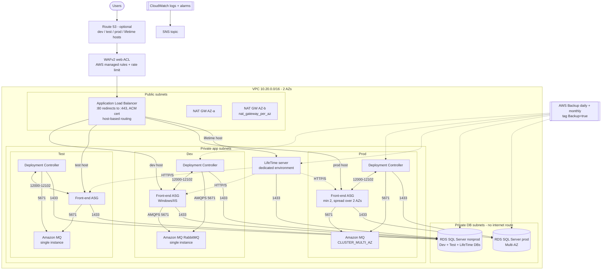

# infra — AWS reference infrastructure for self-managed OutSystems 11

Terraform for the AWS landing zone a platform team would run a
**self-managed OutSystems 11** factory on: Dev, Test and Prod environments,
a dedicated LifeTime environment, and the networking, data, messaging,
security and operations pieces around them.

> Scope: this provisions AWS infrastructure only. It does **not** install,
> license or configure the OutSystems Platform Server, Service Center or
> LifeTime, and `terraform apply` has never been run (it would create
> chargeable resources). The working app for this assessment runs on an
> OutSystems Cloud personal environment, not on this design.

## Topology



## Layout

| File | What it defines |
|---|---|
| `versions.tf` | Providers, default tags, commented S3 + DynamoDB `backend "s3"` block |
| `variables.tf` | Every input, with one object per environment (`dev_environment`, `test_environment`, `prod_environment`) plus `lifetime` |
| `locals.tf` | Enabled-environment map, host names, DB tier mapping |
| `network.tf` | VPC, 2 public, 2 private-app and 2 private-db subnets, IGW, NAT (one per AZ or a single one, via `nat_gateway_per_az`), per-AZ route tables, locked default SG, VPC flow logs |
| `edge.tf` | ALB, access-log bucket, HTTP→HTTPS redirect, HTTPS listener (TLS 1.3/1.2 policy), ACM certificate with optional Route 53 DNS validation, optional Route 53 alias records, WAFv2 web ACL and its logging, ALB/WAF alarms |
| `environments.tf` | One `modules/o11_environment` instance per enabled environment |
| `modules/o11_environment/` | Per environment: front-end launch template + ASG + target group + host rule + CPU target tracking, Deployment Controller EC2, Amazon MQ for RabbitMQ broker + credentials secret, security groups with the O11 port matrix, CloudWatch log groups, CloudWatch agent config, alarms |
| `lifetime.tf` | Dedicated LifeTime server, its SG, target group, host rule, log groups and alarms |
| `database.tf` | RDS for SQL Server: shared non-prod instance plus a dedicated Multi-AZ prod instance, DB SGs, enhanced monitoring, alarms |
| `compute.tf` | Windows AMI lookup, shared instance role/profile (SSM, CloudWatch agent, least-privilege secret reads) |
| `kms.tf` | Customer-managed KMS key (rotation on) for logs, secrets, Amazon MQ, RDS, Performance Insights and the backup vault |
| `monitoring.tf` | The SNS alarm topic (every alarm notifies it), optional email subscription, SES/SMTP note |
| `backup.tf` | AWS Backup vault, daily (35 d) and monthly (cold after 30 d, kept 365 d) rules, tag-based selection, failed-job alarm |
| `outputs.tf` | What an administrator needs to install the platform: controller IPs, MQ endpoints, DB endpoints, secret ARNs, hosts |
| `env/*.tfvars.example` | `common`, `dev`, `test`, `prod` examples |
| `bootstrap/` | One-off S3 state bucket + DynamoDB lock table (old state versions expire after 90 days) |
| `tests/*.tftest.hcl` | Offline `terraform test` suites with mocked providers (see "Validation and tests") |
| `.tflint.hcl` | tflint config: terraform recommended preset + AWS ruleset 0.38.0 |

## Usage

```bash
cd infra
terraform init -backend=false        # or a real init once the backend is configured
terraform fmt -check -recursive
terraform validate

# Review only. Copy the examples to *.tfvars (git-ignored) first.
for f in common dev test prod; do cp env/$f.tfvars.example env/$f.tfvars; done
terraform plan \
  -var-file=env/common.tfvars -var-file=env/dev.tfvars \
  -var-file=env/test.tfvars  -var-file=env/prod.tfvars
```

To leave an environment out, set its `enabled = false`. For example,
`prod_environment.enabled = false` drops the prod module and the prod RDS
instance. The DB tiers and LifeTime wiring follow the enabled set.

### Remote state

1. `cd bootstrap && terraform init && terraform apply -var state_bucket_name=sgfsf-o11-tfstate-<account-id>`
   (local state, applied once per account).
2. Uncomment the `backend "s3"` block in `versions.tf` and fill in the
   bucket and table names.
3. `cd .. && terraform init -migrate-state`.

With Terraform 1.10 or later you can use `use_lockfile = true` and skip the
DynamoDB table. The table is kept for older CLIs.

## Validation and tests (18 Oct 2026, run locally, not on GitHub Actions)

Every check below was run on a Linux box with `scripts/check-all.sh` from the
repo root. The full output is committed in
[`docs/test-evidence/local-run-2026-10-18.txt`](../docs/test-evidence/local-run-2026-10-18.txt).
Tool versions: Terraform 1.9.8, AWS provider 5.100.0, tflint 0.64.0 (terraform
recommended preset + AWS ruleset 0.38.0), checkov 3.3.29. `scripts/install-tools.sh`
installs the same versions and checks each download against the vendor's
SHA-256 checksum file.

| Check | Result |
|---|---|
| `terraform fmt -check -recursive` | pass |
| `terraform init -backend=false` + `terraform validate` (root and `bootstrap/`) | `Success! The configuration is valid.` (both) |
| `tflint --recursive` | 0 issues |
| `checkov -d infra --framework terraform` | 323 passed, 0 failed, 15 skipped (was 314 / 24 / 0 on 17 Oct) |
| `terraform test` (offline, mock providers) | 10 passed, 0 failed |
| Real `terraform plan` / `apply` against AWS | **not run**: no AWS account. With fake keys the provider stops at `STS GetCallerIdentity` (403 `InvalidClientTokenId`) |
| LocalStack | **not run**: RDS and Amazon MQ are not in LocalStack's free tier ([LocalStack plans](https://docs.localstack.cloud/aws/licensing/), read 18 Oct 2026) |

`validate` checks syntax, types and references. `terraform test` goes one
step further: it builds a full plan of the root module and of the
environment module against mocked AWS and random providers, and asserts on
the planned values. Neither proves that AWS will accept the plan (quotas,
engine versions, instance-class availability in the region). Only a real
`terraform plan` in an AWS account can show that.

### What `terraform test` asserts

`infra/tests/platform.tftest.hcl` (root module, 8 runs):

- 2 public, 2 private-app and 2 private-db subnets, each tier across two AZs;
  one NAT gateway per AZ by default; VPC flow logs capture ALL traffic.
- RDS: a shared non-prod and a dedicated prod instance; prod is Multi-AZ; both
  SQL Server, encrypted, not public, at least 7 days of PITR, deletion
  protection, a final snapshot, the master password held by RDS in Secrets
  Manager, and tagged `Backup=true`.
- SQL Server 1433 is only reachable from platform security groups, never from
  a CIDR. No RDP rule exists unless admin CIDRs are given. The ALB accepts only
  80 and 443.
- HTTPS listener on 443 with a TLS 1.3/1.2 policy; port 80 answers with a 301
  to HTTPS; the ALB drops invalid headers, has deletion protection and access
  logs; the WAF has all seven expected rules; the log bucket blocks public access.
- KMS key rotation on; log groups keep at least 365 days; CPU, storage and
  memory alarms per RDS instance; ALB 5xx, backup-failure and LifeTime alarms;
  AWS Backup keeps at least 35 days and selects `Backup=true`.
- Dev, Test, Prod and a dedicated LifeTime host; LifeTime enforces IMDSv2 and
  an encrypted root volume.
- With one NAT gateway and prod disabled, the plan still works and creates no
  prod database or host. Restricted RDP opens only to the given CIDR.
- Rejected inputs: RDP from `0.0.0.0/0`, PITR under 7 days, a log retention
  CloudWatch does not accept, the same AZ twice, and AZs outside the region.

`infra/tests/environment.tftest.hcl` (environment module, 2 runs):

- Prod: at least 2 front-ends across both subnets, ELB health checks, IMDSv2,
  encrypted volumes, no sticky sessions (OutSystems advises against them on
  farms); the Deployment Controller has IMDSv2, an encrypted volume and
  `Backup=true`.
- The OutSystems port matrix exactly: front-end to controller 12000/12100;
  controller to front-end 80, 12001/12101, 12002/12102; RabbitMQ only on 5671.
  Every platform port is opened to a security group, never to a CIDR.
- Amazon MQ is private RabbitMQ, a Multi-AZ cluster in prod, encrypted with the
  platform key; all 7 environment alarms notify SNS; the controller alarm also
  auto-recovers the instance.
- Dev: a single-instance broker takes one subnet; restricted RDP opens only to
  the admin CIDR; no LifeTime rules when LifeTime is off.

The tests were checked against deliberate breakage: with prod set to single-AZ
and front-end stickiness switched on, the run reported `8 passed, 2 failed`,
naming exactly those two assertions. Both changes were then reverted.

**A real defect the tests found.** The LifeTime security-group rules in the
environment module used `for_each` over a list chosen by whether the LifeTime
security-group ID was empty. In a fresh account that ID is unknown until
apply, so the first `terraform plan` would have stopped with "Invalid for_each
argument". `validate` cannot see this. The module now takes a plain
`lifetime_enabled` flag, and the plan builds.

### Changes made on 18 Oct after the scan

Fixed (9 checkov findings):

| Check | Change |
|---|---|
| CKV_AWS_338 x6 (log retention < 1 year) | `log_retention_days` and `flow_logs_retention_days` now default to 365 and only accept values CloudWatch Logs allows. |
| CKV2_AWS_76 (Log4j managed rules) | Added `AWSManagedRulesAnonymousIpList` in COUNT mode. checkov requires it next to KnownBadInputs. COUNT, not block, because a public service should not block people who use a VPN. The 17 Oct note blamed checkov for not resolving the association; that was wrong. |
| CKV_AWS_394 (AZ pinning) | AZs are now a variable (`ap-southeast-1a`, `ap-southeast-1b`) with checks: two distinct zones, both inside `region`. Before, the first two names from a data source were used. |
| CKV2_AWS_61 (state bucket lifecycle) | `bootstrap/`: old state versions expire after 90 days; failed uploads are cleaned up after 7. |

Other guard rails added: `allowed_rdp_cidr_blocks` rejects `0.0.0.0/0` and
`::/0`; `db_backup_retention_days` must be 7 to 35.

Accepted (15 findings, each skipped inline with `#checkov:skip=<id>:<reason>`
next to the resource, so the reason is in the code):

| Check | Resource | Why it stays |
|---|---|---|
| CKV_AWS_157 RDS Multi-AZ | `aws_db_instance.platform` | Only the shared non-prod instance is single-AZ (cost). Prod is Multi-AZ, and a test asserts it. |
| CKV_AWS_378 HTTP target group (x2) | front-end and LifeTime target groups | TLS ends at the ALB; ALB to IIS is HTTP on port 80 inside private subnets. Re-encrypting needs a certificate on every IIS host. |
| CKV_AWS_260 port 80 from 0.0.0.0/0 (x2) | `fe_http_from_alb`, `lifetime_from_alb` | False positive. The source is the ALB security group, not a CIDR. |
| CKV2_AWS_34 SSM parameter not encrypted | CloudWatch agent config | Holds log paths and metric names only, no secrets. |
| CKV2_AWS_57 secret rotation | RabbitMQ secret | Rotating it needs the same change in the OutSystems Configuration Tool (Cache tab), so it is a runbook step. RDS rotates its own master secret. |
| CKV_AWS_145 S3 KMS | ALB log bucket | ALB access-log delivery supports only SSE-S3 ([AWS docs](https://docs.aws.amazon.com/elasticloadbalancing/latest/application/enable-access-logging.html): "The only server-side encryption option that's supported is Amazon S3-managed keys (SSE-S3)"). |
| CKV_AWS_18 / CKV2_AWS_62 / CKV_AWS_144 (x2 each) | ALB log bucket, state bucket | Access logging of log buckets, event notifications and cross-region replication are left out of a single-region reference. |
| CKV_AWS_119 DynamoDB CMK | lock table | Holds lock IDs only; AWS-owned encryption at rest is enough. |

## Design decisions

- **One VPC, environments isolated by security groups.** Each environment has
  its own front-end, controller and MQ security groups, and only its own
  servers can reach its DB tier. Separate accounts or VPCs per environment
  isolate better but cost more and need peering or Transit Gateway for
  LifeTime. That is a reasonable next step for a regulated production.
- **One shared ALB with host-based routing**, giving one WAF, one cert and one
  access log. Unknown hosts get a 404. Production could move to its own ALB
  without changing the module.
- **Front-ends in an ASG and controllers as plain EC2.** Front-ends are
  stateless (the controller redeploys apps to new nodes), so they autoscale
  on CPU. The Deployment Controller and LifeTime are stateful single
  servers that front-ends register against. Plain instances keep stable
  IPs, are backed up by AWS Backup and auto-recover on host failure.
- **No sticky sessions.** OutSystems keeps sessions in the database and
  advises against LB stickiness. `stickiness.enabled = false`.
- **Amazon MQ for RabbitMQ as the cache invalidation service**, one broker per
  environment. That's single-instance for Dev/Test and a 3-node Multi-AZ
  cluster for Prod. This replaces the RabbitMQ the installer otherwise puts
  on the controller, which takes that SPOF off the controller.
- **Two RDS tiers.** Dev, Test and LifeTime share one single-AZ instance as
  separate databases. Prod gets a dedicated Multi-AZ instance with
  synchronous standby.
- **NAT per AZ, behind a toggle.** `nat_gateway_per_az = true` keeps egress
  alive if an AZ fails. `false` saves a NAT gateway for non-prod accounts.
- **Secrets never in Terraform.** RDS generates and holds its master
  password (`manage_master_user_password`). The RabbitMQ password is
  generated by `random_password` into Secrets Manager. That value does
  sit in Terraform state, which is why the encrypted, versioned S3 backend
  matters.
- **Observability.** The CloudWatch agent config in SSM ships IIS, OutSystems
  and Windows event logs into per-environment log groups. VPC flow logs and
  WAF logs go to CloudWatch, and ALB access logs to S3. Every alarm
  (ASG CPU, unhealthy hosts, 5xx, p95 latency, controller and LifeTime
  status checks with auto-recover, MQ CPU, RDS CPU/storage/memory, ELB
  5xx, WAF block spikes, failed backups) notifies the one SNS topic.
- **SES / SMTP.** OutSystems sends email through the SMTP server set in
  Service Center. The intended relay is Amazon SES SMTP
  (`email-smtp.ap-southeast-1.amazonaws.com:587`, STARTTLS), which is why
  platform servers may egress on 587. The verified domain identity,
  DKIM records and SMTP credentials are created outside this stack because
  they belong to the agency's mail domain. Request SES production access
  before go-live.

## Cost and scale

The defaults stand up a whole factory, so this is not a small bill. Price
it with the AWS Pricing Calculator for ap-southeast-1 before any apply.
No figures here have been priced. Billable units with the default tfvars:

- 8 Windows EC2 instances: front-ends 1 + 1 + 2, three controllers and
  LifeTime. Windows licence-included pricing roughly doubles the Linux rate.
- 2 RDS for SQL Server Standard instances, licence included. The prod
  one is Multi-AZ, which bills two instances' worth. **This is usually the
  biggest line item.**
- Amazon MQ: 2 × `mq.t3.micro` single instances and a 3-node `mq.m5.large`
  cluster.
- 2 NAT gateways plus data processing, 1 ALB, 1 WAF web ACL with 6 rules,
  CloudWatch logs and metrics, AWS Backup storage.

Levers to bring it down:

- Turn off Test outside working hours.
- Set `nat_gateway_per_az = false` outside prod.
- Use a smaller non-prod DB class.
- Run Dev without Amazon MQ (the installer's local RabbitMQ).
- Use reserved instances or savings plans for prod.
- Look at SQL Server Web edition only if licensing allows it.

To scale, raise `prod_environment.fe_max` (CPU target tracking at
60%) and the RDS instance class or storage ceiling. Add a dedicated
scheduler front-end or separate deployment zones when timers or
integrations compete with user traffic.

## Assumptions (checked against the OutSystems docs where noted)

Confirmed in the official OutSystems 11 docs:

- Each environment needs a Deployment Controller, and the front-end
  role can share a server with it or run standalone. The Scheduler role
  (timers, BPT, email) is on by default on every front-end.
  Source: [OutSystems platform server roles](https://success.outsystems.com/documentation/11/setup_outsystems_infrastructure_and_platform/designing_outsystems_infrastructures/outsystems_platform_server_roles/).
- LifeTime must run in a dedicated environment. "Installing LifeTime in an
  existing environment is not supported from version OutSystems 11
  onwards." Source: [Possible setups for an OutSystems infrastructure](https://success.outsystems.com/documentation/11/setup_outsystems_infrastructure_and_platform/setting_up_outsystems/possible_setups_for_an_outsystems_infrastructure/).
- Port matrix: front-end → controller 12000 (and 12100 on Platform Server
  11.25+); controller → front-end 12001 (12101 on 11.24+); 12002/12102
  scheduler monitoring; 80 for IIS monitoring; 1433 to SQL Server; 5672 to
  the cache invalidation service. These ports should not be open to the
  internet. Source: [OutSystems 11 network requirements](https://success.outsystems.com/documentation/11/setup_outsystems_infrastructure_and_platform/setting_up_outsystems/outsystems_11_network_requirements/).
- Avoid sticky sessions on OutSystems farms, because sessions live in the
  session database. Source: [Recommended configurations for load balancing](https://success.outsystems.com/documentation/11/setup_outsystems_infrastructure_and_platform/setting_up_outsystems/recommended_configurations_for_load_balancing/).
- Cache invalidation runs on RabbitMQ. A highly available RabbitMQ cluster
  and TLS are documented options. Sources: [Cache invalidation in OutSystems 11](https://success.outsystems.com/documentation/11/setup_outsystems_infrastructure_and_platform/setting_up_outsystems/cache_invalidation_in_outsystems_11/),
  [Cache invalidation with high availability](https://success.outsystems.com/documentation/11/setup_outsystems_infrastructure_and_platform/setting_up_outsystems/cache_invalidation_in_outsystems_11/outsystems_cache_invalidation_with_high_availability/).

Assumptions I could not confirm:

- **Amazon MQ as the RabbitMQ.** OutSystems documents self-installed RabbitMQ
  clusters, not Amazon MQ specifically. Amazon MQ for RabbitMQ only
  accepts AMQPS on 5671, so the platform has to be configured for TLS to
  the broker. Validate this with OutSystems support. The fallback is
  self-managed RabbitMQ on EC2, or the installer's default local service.
- **RDS for SQL Server for the platform database.** RDS does not grant
  `sysadmin`. The Platform Server configuration tool's database-creation
  step may need the databases and logins created up front with the
  documented permissions. Check this against the
  [OutSystems 11 system requirements](https://success.outsystems.com/documentation/11/setup_outsystems_infrastructure_and_platform/setting_up_outsystems/outsystems_11_system_requirements/) for your release.
- **Versions.** Windows Server 2022 (`windows_ami_name_filter`), SQL Server
  2019 (`db_engine_version = "15.00"`) and RabbitMQ 3.13 are all
  parameters. Confirm each against the system requirements matrix for the
  exact Platform Server version.
- **Sizing.** Instance types are starting points, not OutSystems sizing guidance.
- **LifeTime cache invalidation** uses the RabbitMQ installed locally on the
  LifeTime server, and its database lives on the non-prod RDS instance.
- **LifeTime connectivity** to the environments is direct inside the VPC over
  HTTP/S (security-group rules on 80/443). This was not checked against a
  specific LifeTime port list.
- **Health check path** is `/` on IIS. Replace it with a lightweight app or
  platform endpoint once the platform is installed.
- **WAF:** the Core rule set's `SizeRestrictions_BODY` is set to COUNT
  because OutSystems uploads (solution packs, large screen-service posts)
  can exceed it. Revisit after watching real traffic.
- **IIS features** in user data are a placeholder list. The Platform Server
  installer's prerequisite step is authoritative.
- **OutSystems log path** (`C:\Program Files\OutSystems\Platform Server\logs`) in
  the CloudWatch agent config assumes the default install directory.

Installation reference: [Setting up OutSystems](https://success.outsystems.com/documentation/11/setup_outsystems_infrastructure_and_platform/setting_up_outsystems/).

## Out of scope

- Installing and licensing the Platform Server, Service Center and LifeTime,
  and registering environments in LifeTime.
- Platform upgrades, patching runbooks, DR drills and restore testing.
- VPN or Direct Connect, an AD or identity-provider integration, and
  cross-region DR.
- Setting or rotating secret values beyond what RDS and Terraform generate.
- `terraform apply`. Never run it without explicit approval, because it
  incurs AWS costs.
